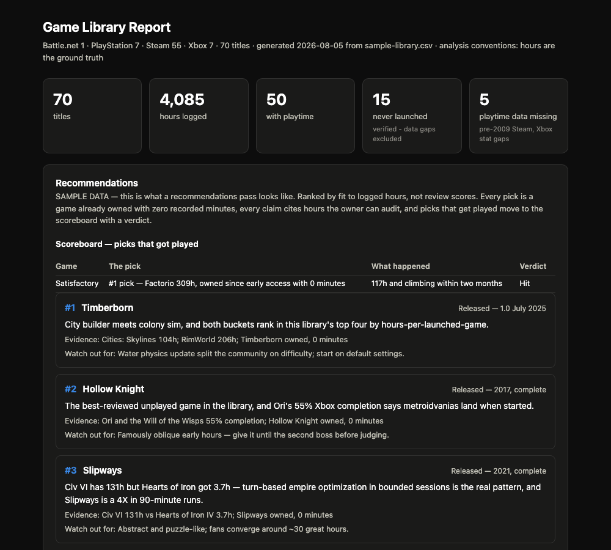
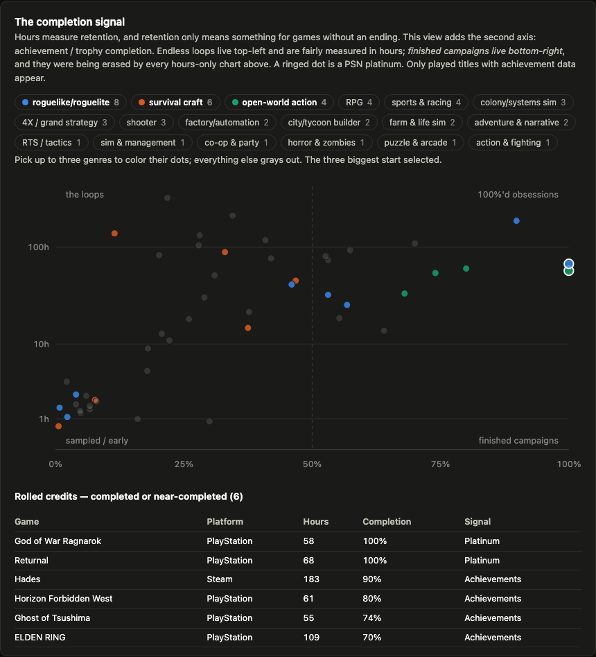
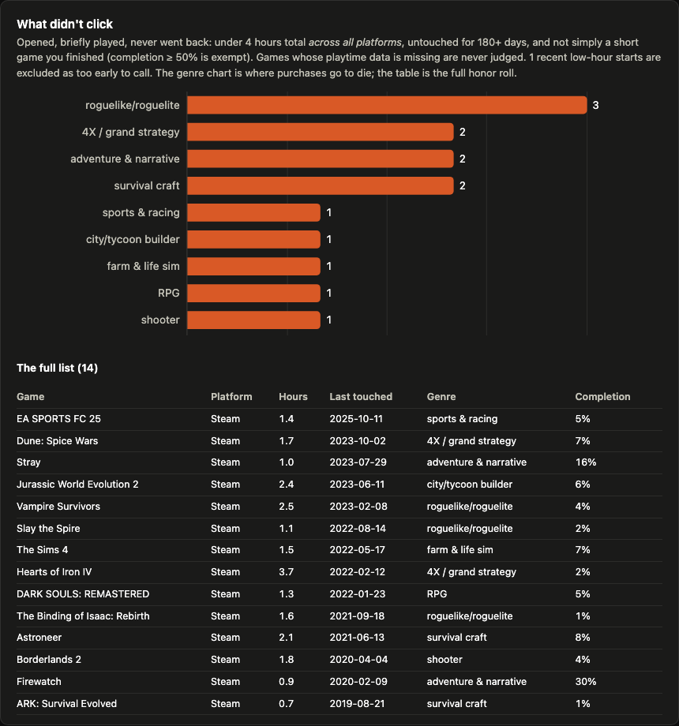

# Game Library Analysis

Pull your gaming library — Steam, Xbox, PlayStation, and the launchers with no
API at all — into one interactive report and Excel workbook, then get "what
should I play next" recommendations grounded in the hours you actually logged,
not review scores.

The premise: **people are unreliable narrators of their own taste.** You'll say
you love roguelikes when one outlier carries 90% of the genre's hours. Your
library is the ground truth. This project leads with it — including a skip list
of games your own data quietly rules out, a completion axis so finished
campaigns aren't erased by endless loops, and a scoreboard where the
recommender's own hit rate is public.



*All screenshots show the bundled [sample dataset](examples/sample-library.csv);
build the full interactive sample report with one command and click around:

```bash
python -m game_library_analysis.build_report examples/sample-library.csv --recs examples/sample-recommendations.json --out sample-report.html
``` Light mode included:*

| The completion quadrant | What didn't click |
| --- | --- |
|  |  |

This repo is a Claude plugin with one [skill](https://docs.claude.com/en/docs/agents-and-tools/agent-skills):
install it (or point Claude at the folder) and
[`SKILL.md`](skills/game-library-analysis/SKILL.md) drives the workflow. The pipeline itself is a
plain Python package — [`game-library-analysis` on PyPI](https://pypi.org/project/game-library-analysis/),
source at [roloc/game-library-pipeline](https://github.com/roloc/game-library-pipeline) —
and runs standalone, with no AI account at all.

## What you can ask

Once the skill is installed, these all trigger it:

- **"What should I play next from my Steam backlog?"** — finds the genres
  where your hours actually concentrate and ranks unplayed games you already
  own, with the hours behind each pick.
- **"Should I buy this new release?"** — checks it against your history. If
  you have bounced off every game in that genre in under an hour, it says so
  and puts it on the skip list.
- **"Add my Xbox and PlayStation libraries too."** — merges a second or third
  platform into the same workbook, so a game you played on console is not
  recommended to you on PC.
- **"Which games did I actually finish?"** — charts completion against hours
  from achievements and trophies, separating finished campaigns from games
  you only sampled.
- **"What have I bought and never really played?"** — lists never-launched
  titles and early bounces by genre.
- **"Refresh my library and score your last recommendations."** — re-pulls
  playtime, moves picks you acted on to the scoreboard with a verdict, and
  re-ranks the rest.

## Quick start

```bash
pip install game-library-analysis   # or 'game-library-analysis[psn]' for PlayStation
game-library     # no config yet? it walks you through setup interactively
```

The first run launches a guided setup: which platforms you want, where each
key comes from, and the Steam privacy settings that trip everyone up — keys
are typed locally into `config.env` in the folder you run from, and you can
re-run it anytime with `game-library --setup`. (Prefer files? `cp
skills/game-library-analysis/assets/config.example.env config.env` and fill it in yourself.)

`game-library` fetches every platform you gave it credentials for, merges them
into one normalized CSV, and produces two outputs in `data/`:

- **`library.xlsx`** — the analysis workbook (below)
- **`report.html`** — a self-contained interactive dashboard: headline stats,
  hours by genre, the hours-per-launched-game concentration signal, top 20
  titles, a recency scatter, and played-vs-never-launched by genre. No CDNs,
  works offline, light and dark mode.

Re-run any time to refresh; `game-library --no-fetch` rebuilds outputs from
the existing CSV without touching the network. The individual steps run
standalone too (`python -m game_library_analysis.fetch_steam`, etc. — see the
[pipeline repo](https://github.com/roloc/game-library-pipeline)). `config.env` and `data/`
are read from and written to the folder you run from.

Two things first-time runners hit:

- **`game-library` produces the measurements, not the recommendations.** The
  ranked picks / skip list / scoreboard are a judgment pass: have Claude
  run the skill's analysis — it writes
  `data/recommendations.json`, and the next rebuild renders it. If your
  report has no Recommendations section, that pass hasn't happened yet.
- **Steam achievements need one extra privacy setting.** *Game details*
  public is enough for the library, but the completion signal also needs
  Steam → Edit Profile → Privacy Settings → **"My profile" = Public** while
  pulling (Steam blocks achievements even to your own key without it). Flip
  it, run, flip it back — the cache persists.

### The workbook

Four sheets:

| Sheet | Contents |
| --- | --- |
| Summary | Counts and hours by genre — all live formulas |
| Recommendations | Ranked picks, written by hand from the analysis (see SKILL.md) |
| Library | Every title by hours, with a Status column for you to fill in |
| Backlog | Zero-playtime titles, with pre-2009 untracked ones split out |

Yellow-filled, blue-font cells are yours to fill in; the Summary formulas
follow your edits.

## Using it with Claude (the analyst half)

The pipeline above is plain Python — no AI account needed for the data pull,
workbook, or dashboard. Claude is the *judgment layer*: the analysis pass,
recommendations with auditable hour citations, the skip list, genre tagging,
and the recommender's scoreboard. This repo is shaped as a
[Claude skill](https://docs.claude.com/en/docs/agents-and-tools/agent-skills):
[`SKILL.md`](skills/game-library-analysis/SKILL.md) is the methodology, [`references/`](skills/game-library-analysis/references)
the domain knowledge.

There is nothing to wire up — no Anthropic API key goes in `config.env`. You
use your own Claude account:

- **Claude Code — easiest: install as a plugin** (no clone needed; the repo
  is its own marketplace). In any Claude Code session:

  ```
  /plugin marketplace add roloc/game-library-analysis
  /plugin install game-library-analysis@game-library-analysis
  ```

  The skill then triggers automatically on questions like "what should I
  play next?" or "analyze my Steam library."

- **Claude Code — manual:** clone the repo, open the folder, and say *"read
  skills/game-library-analysis/SKILL.md and run the workflow for my library"* — or
  symlink the skill folder as a personal skill:

  ```bash
  ln -s "$(pwd)/skills/game-library-analysis" ~/.claude/skills/game-library-analysis
  ```

- **claude.ai and Cowork:** zip the `skills/game-library-analysis` folder and upload it
  under Customize → Skills, or add its `SKILL.md` and `references/` files to
  a Project and chat. (That's how this project started.)

Claude usage bills to your own plan; the scripts never call any AI API
themselves.

## Adding platforms

Each fetcher writes the same normalized CSV. Concatenate them (keep one header
row) and rebuild — the workbook grows a Platform column automatically.

- **Xbox** — `python -m game_library_analysis.fetch_xbox`, via a free [OpenXBL](https://xbl.io) key.
  Newest and least battle-tested fetcher; last-played dates are more reliable
  than hours on Xbox generally.
- **PlayStation** — `python -m game_library_analysis.fetch_psn`, via the `psnawp` library
  (`pip install PSNAWP`). **Read the warnings in `config.example.env` first:**
  Sony has no official API, the NPSSO token this route needs is
  password-equivalent, and heavy unofficial API use carries a documented
  account-ban risk (a one-shot pull is very unlikely to trip it, but the call
  is yours). [`references/platforms.md`](skills/game-library-analysis/references/platforms.md) covers
  two zero-risk alternatives.
  PSN also only reports *played* titles, so there is no PSN backlog view.
- **Battle.net, Epic, GOG, EA App, console-screen readings** — no APIs exist,
  so these go in `data/manual.csv` (schema in
  [`manual.example.csv`](skills/game-library-analysis/assets/manual.example.csv)), which `game-library`
  merges automatically. For WoW, the in-game `/played` command is exact; see
  `references/platforms.md`.

## Data and credentials

Everything this plugin produces stays in the folder you run it from:
`config.env` (your keys) and `data/` (pulls, caches, the workbook, the
report). There is no telemetry and no server of ours.

The only network calls are to the platforms you choose to configure, and
each key you supply is sent only to the service that issued it:

| You provide | Sent to | For |
| --- | --- | --- |
| Steam Web API key + your Steam ID or vanity name | `api.steampowered.com` | Library, playtime, achievements |
| OpenXBL API key | `xbl.io` | Xbox title history, playtime, achievements |
| PSN NPSSO token (optional) | Sony's PSN endpoints, via the `psnawp` library | Played titles and trophies, pulled once and cached |

Nothing is read from your environment beyond those values, which `game-library`
passes from `config.env` to the matching fetcher; a fetcher run by hand
reads the same variable name (for example `STEAM_API_KEY`). Keys are never
printed, logged, or written anywhere except the `config.env` you created.

In a clone of this repo `config.env` and `data/` are gitignored. Run from any
other git repository, add them to its `.gitignore` — `game-library` warns if it
finds `config.env` committable.

If you're running this with an AI assistant: the assistant can run `game-library`
without ever reading `config.env` — never paste a key, NPSSO, or session
token into a chat, and if you already have, regenerate it.

## Layout

```
.claude-plugin/plugin.json        plugin manifest
skills/game-library-analysis/     the skill - everything an install ships
  SKILL.md                        the workflow: how to analyze, what makes recommendations trustworthy
  references/platforms.md         per-platform data access routes and their tradeoffs
  references/analysis.md          how to read a library: signals, confounders, framing
  references/completion-signal.md the achievements/trophies axis
  assets/config.example.env       copy to config.env and fill in
  assets/manual.example.csv       schema for launchers with no API
  assets/genres.json              name->genre seed (a working-dir genres.json overrides it)
  assets/pre2009_appids.json      Steam titles that predate playtime tracking
examples/                         synthetic sample library and recommendations

The pipeline the skill drives (fetchers, merge, workbook and report builders)
is the game-library-analysis package: https://github.com/roloc/game-library-pipeline
```

## The completion signal

Hours measure retention, which lies about finite games: a finished 100-hour
Elden Ring run isn't "less" than an endless loop game's 300 hours.
Achievements and trophies add the second axis: the report gains a
completion-vs-hours quadrant chart and a "rolled credits" list, the workbook
a Completion % column and a Completed sheet. Design and field notes in
[`references/completion-signal.md`](skills/game-library-analysis/references/completion-signal.md). PSN trophy data is pulled **once** and
cached locally (`data/psn_trophies.json`) — the pipeline never re-hits
Sony's unofficial API unless you delete the cache. Steam achievements
require the profile's "My profile" privacy set to Public while pulling.

## Buy me a game 🎮

If this told you something true about your own taste (or found your next
300-hour game in the pile you already own), you can say thanks:

[](https://ko-fi.com/roloc59)

**[ko-fi.com/roloc59](https://ko-fi.com/roloc59)**

No paywall and no telemetry either way. Your library data stays on your
machine; the only network calls are to the platforms you configure.

## The normalized CSV

```
platform,id,name,minutes,last_played,genre,note
Steam,427520,Factorio,16637,2024-11-16,,
Steam,400,Portal,0,,,Playtime untracked (pre-2009)
```

`genre` may be blank (the builder fills it from `assets/genres.json`);
`last_played` is `YYYY-MM-DD` or empty; `minutes` is an integer.
